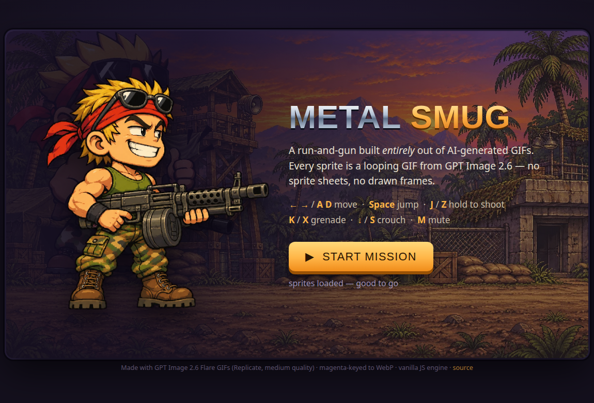

# METAL SMUG 😏

A playable Metal Slug parody run-and-gun whose **every sprite is a looping GIF
generated by GPT Image 2.6**. No sprite sheets, no hand-drawn frames — one smug
hero, **SARGE SMUG**, who has never once been worried.

**▶ Play it live: https://metal-smug.pages.dev**



## How to play

| Input | Action |
|---|---|
| ← → or A / D | Move |
| Space / W / ↑ | Jump (the arc is baked into the GIF) |
| J / Z (hold) | Shoot |
| K / X | Throw grenade (limited, +3 per wave) |
| ↓ / S | Crouch |
| M | Mute |

Clear 3 waves of grunts and grenade-lobbers, then take down the tank boss.
3 hearts. Grunt +100, lobber +150, tank +1000. Touch buttons appear on mobile.

## How it was made

1. **Generation** — All 16 character/effect animations are GIFs from
   **GPT Image 2.6 Flare** via the [Replicate](https://replicate.com/openai/gpt-image-2.6-flare)
   API at **medium quality**. GIF generation on that model accepts **no input
   images**, so character consistency is *prompt-only*: a verbatim character
   description block (in [`assets-original/CHARACTER-BLOCK.md`](assets-original/CHARACTER-BLOCK.md))
   was pasted into every prompt. Every GIF was generated on a flat magenta
   (#FF00FF) background. (One asset, the grunt death, was blocked by the model's
   content filter twice — deaths are done in-engine instead: explosion overlay +
   tip-over + fade.)
2. **Keying** — [`tools/key_assets.py`](tools/key_assets.py) chroma-keys the
   magenta per frame (distance-to-magenta alpha, edge feather, despill), crops
   to the union content bbox (preserving in-frame motion like the jump arc),
   normalizes hero content heights to the idle asset, and exports animated
   WebP into [`assets/`](assets/). Original GIFs are kept in
   [`assets-original/`](assets-original/).
3. **Engine** — [`game.js`](game.js): a thin vanilla-JS state machine that
   swaps `` sources per state and moves DOM sprites. Bullets, grenades,
   physics, waves, boss AI, HUD and WebAudio bleeps — no framework, no build
   step. Open `index.html` and it runs.

Full design doc: [`GAME-DESIGN.md`](GAME-DESIGN.md) · Phase-1 production log:
[`assets-original/PRODUCTION-LOG.md`](assets-original/PRODUCTION-LOG.md)

## Layout

```
index.html / style.css / game.js   the game (static, no build)
assets/                            keyed animated WebP sprites + bg
assets-original/                   original GPT Image GIFs + character blocks
tools/key_assets.py                magenta → transparency pipeline
```
